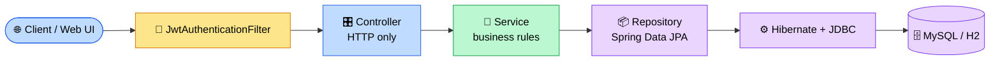
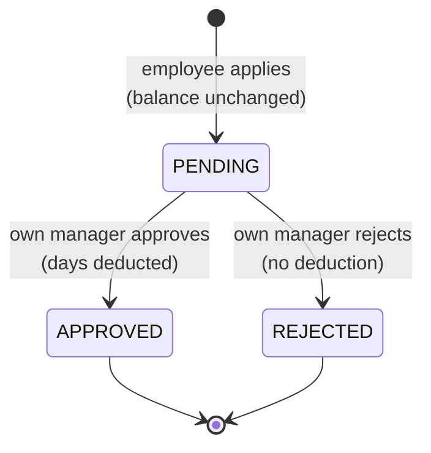

<div align="center">


<br/>


**Employees apply for leave. Their own manager approves or rejects it. The rules are enforced by the server.**

[Quick start](#-quick-start) · [Web UI](#-built-in-web-ui) · [Endpoints](#-endpoints) · [Business rules](#-business-rules) · [Tests](#-tests)

</div>

---

## ✨ Features

| | Feature | Details |
|---|---|---|
| 🔐 | **JWT authentication** | Stateless login, BCrypt password hashing, JSON 401 and 403 errors |
| 🛡️ | **Role-based access** | `EMPLOYEE` and `MANAGER` endpoints separated with `@PreAuthorize` |
| 📅 | **Smart leave rules** | No past dates, balance check, no overlapping requests, inclusive day count |
| ✅ | **Safe approvals** | Only the employee's own manager, only `PENDING` requests, balance re-checked at approval |
| ⚔️ | **Concurrency safe** | Optimistic locking (`@Version`) stops two approvals from over-deducting |
| 🖥️ | **Built-in web UI** | One HTML page served by Spring Boot, no Node.js needed |
| 🗄️ | **Persistent database** | MySQL (Docker) or H2 file mode with a browser SQL console |
| 🧪 | **28 unit tests** | JUnit 5 and Mockito, no database needed |

---

## 🏗️ Architecture



> Controllers only handle HTTP. All business rules live in the service layer. Entities are never exposed: the API uses DTOs only.

<details>
<summary><b>📁 Project structure</b></summary>

```
src/main/java/com/example/leave
├── controller/   AuthController, LeaveController          (HTTP only, no business logic)
├── service/      AuthService, LeaveService                (all business rules)
├── repository/   EmployeeRepository, LeaveRequestRepository
├── entity/       Employee, LeaveRequest, Role, LeaveType, LeaveStatus
├── dto/          Request/Response records, ErrorResponse
├── validation/   @ValidDateRange custom validator
├── exception/    Custom exceptions + GlobalExceptionHandler (@RestControllerAdvice)
├── security/     JwtService, JwtAuthenticationFilter, SecurityConfig, UserDetails...
└── config/       ClockConfig, ManagerSeeder
src/main/resources/application.yml        (externalized DB / JWT config)
src/main/resources/application-h2.yml     (H2 file-mode profile + console)
src/main/resources/static/index.html      (built-in web UI)
postman/                                   (Postman collection + .http file)
docker-compose.yml                         (MySQL for local dev)
```

</details>

---

## 🚀 Quick start

**Prerequisites:** JDK 17 or newer and Maven 3.9+. No database install needed for the H2 option.

### Option A: H2 file mode (easiest, data is kept between restarts)

```bash
mvn spring-boot:run "-Dspring-boot.run.profiles=h2"
```

| What | Where |
|---|---|
| 🖥️ App and web UI | http://localhost:8080 |
| 🗄️ Database console | http://localhost:8080/h2-console |

Console login: JDBC URL `jdbc:h2:file:./data/leave_db;MODE=MySQL`, user `sa`, empty password.
Data is stored in the `data/` folder (ignored by git). Stop the server with `Ctrl+C`.

### Option B: MySQL with Docker

```bash
docker compose up -d        # MySQL 8 on port 3306, database leave_db
mvn spring-boot:run
```

<details>
<summary><b>🪟 Windows PowerShell tips</b></summary>

If `mvn` is not recognized in a new terminal, add Maven to the PATH for that session
(change the folder if Maven is installed elsewhere):

```powershell
$env:Path += ";$env:USERPROFILE\apache-maven-3.9.11\bin"
```

If port 8080 is still busy from an earlier run:

```powershell
Get-Process java -ErrorAction SilentlyContinue | Stop-Process -Force
```

If you see `Not a managed type`, run `mvn clean spring-boot:run "-Dspring-boot.run.profiles=h2"`.

</details>

<details>
<summary><b>☕ Java 24/25 note</b></summary>

On JDK 24+ the `pom.xml` passes `-Dnet.bytebuddy.experimental=true` to the tests and to `spring-boot:run`
(Mockito and Hibernate use Byte Buddy, which does not officially support the newest JDKs yet).
It is harmless on JDK 17 and 21.

</details>

### 🔑 Demo accounts

> ⚠️ **Demo credentials only.** These are sample values for local testing, not real accounts. Change them with environment variables for any real deployment.

| Role | Email | Password |
|---|---|---|
| 👔 Manager (seeded on first start, id `1`) | `manager@company.com` | `Manager@123` |
| 👩 Employee | register one in the UI with Manager ID `1` | your choice (8 to 72 chars) |

---

## 🖥️ Built-in web UI

Open **http://localhost:8080** once the app is running. It is a single static page
(`src/main/resources/static/index.html`, plain HTML, CSS and JavaScript, no build step) that calls the same REST API.

- 🔓 **Login and Register** tabs (new accounts are employees; Manager ID `1` is the seeded manager)
- 👩 **Employee view:** remaining balance, apply form with a live day count, history with `PENDING` / `APPROVED` / `REJECTED` badges, reason and manager comment
- 👔 **Manager view:** pending, approved and rejected counts, filterable team table, **Approve** and **Reject** buttons (reject takes an optional comment)
- 🔄 Refreshes every 10 seconds, so an employee sees a decision without reloading
- 🚫 Server errors (past date, insufficient balance, wrong manager) show as messages on the page
- 🔒 The page is public, but every data call still needs the JWT

---

## 🗄️ Database

| Table | Purpose |
|---|---|
| `employees` | id, name, unique email, BCrypt password, role, department, `manager_id`, `annual_leave_balance` (default 12), `version` |
| `leave_requests` | id, `employee_id`, leave type, start and end date, `number_of_days`, status, reason, `applied_on`, `reviewed_by`, `manager_comment` |

Handy queries for the H2 console:

```sql
SELECT * FROM employees;
SELECT * FROM leave_requests;

SELECT e.name, l.leave_type, l.number_of_days, l.status
FROM employees e JOIN leave_requests l ON e.id = l.employee_id;
```

> Make changes through the UI or API so the rules run. Use the console to read data.

---

## 🔌 Endpoints

| Method | Path | Role | Description |
|---|---|---|---|
| `POST` | `/api/auth/register` | 🌍 public | Register an employee |
| `POST` | `/api/auth/login` | 🌍 public | Returns a JWT |
| `POST` | `/api/leaves` | 👩 EMPLOYEE | Apply for leave |
| `GET` | `/api/leaves/my-history` | 👩 EMPLOYEE | Own leave requests |
| `GET` | `/api/leaves/balance` | 👩 EMPLOYEE | Remaining leave balance |
| `GET` | `/api/leaves/team` | 👔 MANAGER | Requests of employees reporting to me |
| `PUT` | `/api/leaves/{id}/approve` | 👔 MANAGER | Approve (deducts balance) |
| `PUT` | `/api/leaves/{id}/reject` | 👔 MANAGER | Reject, optional `{ "comment": "..." }` |

Send the token on every protected call: `Authorization: Bearer <token>`.

<details>
<summary><b>📨 Sample requests (curl)</b></summary>

**Register**
```bash
curl -X POST http://localhost:8080/api/auth/register -H "Content-Type: application/json" -d '{
  "name": "Asha", "email": "asha@company.com", "password": "Secret@123",
  "department": "Engineering", "managerId": 1
}'
```

**Login**
```bash
curl -X POST http://localhost:8080/api/auth/login -H "Content-Type: application/json" \
  -d '{ "email": "asha@company.com", "password": "Secret@123" }'
```
```json
{ "token": "eyJhbGciOi...", "tokenType": "Bearer", "employeeId": 2, "email": "asha@company.com", "role": "EMPLOYEE" }
```

**Apply for leave**
```bash
curl -X POST http://localhost:8080/api/leaves \
  -H "Authorization: Bearer $EMP_TOKEN" -H "Content-Type: application/json" -d '{
  "leaveType": "CASUAL", "startDate": "2027-01-12", "endDate": "2027-01-14", "reason": "Family function"
}'
```

**Balance and history**
```bash
curl http://localhost:8080/api/leaves/balance -H "Authorization: Bearer $EMP_TOKEN"
curl http://localhost:8080/api/leaves/my-history -H "Authorization: Bearer $EMP_TOKEN"
```

**Manager: team, approve, reject**
```bash
curl http://localhost:8080/api/leaves/team -H "Authorization: Bearer $MGR_TOKEN"
curl -X PUT http://localhost:8080/api/leaves/1/approve -H "Authorization: Bearer $MGR_TOKEN"
curl -X PUT http://localhost:8080/api/leaves/2/reject -H "Authorization: Bearer $MGR_TOKEN" \
  -H "Content-Type: application/json" -d '{ "comment": "Release week - please reschedule" }'
```

</details>

<details>
<summary><b>🪟 PowerShell version of the demo flow</b></summary>

```powershell
$base = "http://localhost:8080"; $json = "application/json"
$mgr = (Invoke-RestMethod -Method Post -Uri "$base/api/auth/login" -ContentType $json -Body '{"email":"manager@company.com","password":"Manager@123"}').token
$m = @{ Authorization = "Bearer $mgr" }

Invoke-RestMethod -Method Post -Uri "$base/api/auth/register" -ContentType $json -Body '{"name":"Asha","email":"asha@company.com","password":"Secret@123","department":"Engineering","managerId":1}'
$emp = (Invoke-RestMethod -Method Post -Uri "$base/api/auth/login" -ContentType $json -Body '{"email":"asha@company.com","password":"Secret@123"}').token
$e = @{ Authorization = "Bearer $emp" }

$s  = (Get-Date).AddDays(30).ToString("yyyy-MM-dd")
$en = (Get-Date).AddDays(32).ToString("yyyy-MM-dd")
$body = @{ leaveType = "CASUAL"; startDate = $s; endDate = $en; reason = "Family function" } | ConvertTo-Json
$leave = Invoke-RestMethod -Method Post -Uri "$base/api/leaves" -Headers $e -ContentType $json -Body $body

Invoke-RestMethod -Method Put -Uri "$base/api/leaves/$($leave.id)/approve" -Headers $m
Invoke-RestMethod -Uri "$base/api/leaves/balance" -Headers $e
```

Security checks:

```powershell
Invoke-RestMethod -Uri "$base/api/leaves/team" -Headers $e      # employee on a manager endpoint -> 403
Invoke-RestMethod -Uri "$base/api/leaves/balance"               # no token -> 401
```

</details>

---

## 📏 Business rules

- 📆 Start date cannot be in the past (today is allowed); end date cannot be before start date.
- 🔢 `numberOfDays` is calculated by the server as **inclusive calendar days** (Mon to Wed = 3, one day = 1). Weekends and holidays are not excluded.
- 💰 Applying fails with **400** if the requested days exceed the remaining balance. Default balance: **12 days**.
- 🚫 A new request cannot overlap another `PENDING` or `APPROVED` request of the same employee (**409**).
- 👔 Only the employee's **own** manager can approve or reject (**403** otherwise).
- ⏳ Only `PENDING` requests can be reviewed (**409** if already approved or rejected), which prevents double deduction.
- ➖ Approval deducts the days from the balance. The balance is re-checked at approval time, and optimistic locking stops concurrent approvals from over-deducting.
- ❌ Rejection never changes the balance.



---

## 🔐 Security

| Layer | How |
|---|---|
| Passwords | Stored as BCrypt hashes, never returned by the API |
| Tokens | JWT (HS256) signed with `JWT_SECRET`, the app refuses to start if the secret is under 32 characters |
| Identity | Taken from the validated token, never from request input |
| Roles | `@PreAuthorize` on controller methods; registration always creates an `EMPLOYEE` |
| Errors | JSON `401` and `403` bodies in the same shape as every other error |
| CSRF | Disabled on purpose: stateless token API with no cookies |

---

## ⚠️ Error format

Every error uses the same JSON shape:

```json
{
  "timestamp": "2026-10-09T03:30:00Z",
  "status": 400,
  "error": "Bad Request",
  "message": "Insufficient leave balance: requested 5 day(s) but only 2 day(s) available",
  "path": "/api/leaves"
}
```

| Status | When |
|---|---|
| 🟠 `400` | Validation errors, malformed JSON, past start date, insufficient balance |
| 🔴 `401` | Missing, invalid or expired token; wrong login credentials |
| 🟣 `403` | Wrong role, or a manager acting on someone else's team |
| 🔵 `404` | Leave request, employee or manager not found |
| 🟡 `409` | Duplicate email, overlapping leave, already reviewed, concurrent update |

---

## 🧪 Tests

```bash
mvn test
```

**28 tests, all passing.** JUnit 5 and Mockito, no database needed.

| Test class | Tests | Covers |
|---|---|---|
| `LeaveServiceTest` | 17 | Day count, balance, past dates, overlap, approve and reject rules, wrong manager, double approval, team view |
| `AuthServiceTest` | 3 | Password hashing, default role and balance, duplicate email, non-manager `managerId` |
| `JwtServiceTest` | 4 | Valid, forged, expired tokens, short secret |
| `LeaveApplyRequestValidationTest` | 4 | Bean Validation including the custom `@ValidDateRange` |

Postman collection and a VS Code REST Client file are in `postman/`.

---

## ⚙️ Configuration

All settings are in `src/main/resources/application.yml` and can be overridden with environment variables:

| Variable | Default | Purpose |
|---|---|---|
| `DB_URL` | `jdbc:mysql://localhost:3306/leave_db?...` | JDBC URL |
| `DB_USERNAME` / `DB_PASSWORD` | `root` / `root` | Database credentials (local dev defaults) |
| `DB_DRIVER` | `com.mysql.cj.jdbc.Driver` | JDBC driver |
| `DDL_AUTO` | `update` | Hibernate schema mode (use `validate` in production) |
| `JWT_SECRET` | dev placeholder | **Change it.** Minimum 32 characters |
| `JWT_EXPIRATION_MS` | `86400000` (24 h) | Token lifetime |
| `SEED_MANAGER_EMAIL` / `SEED_MANAGER_PASSWORD` | demo values above | Default manager account |
| `SERVER_PORT` | `8080` | HTTP port |

**PostgreSQL:** add the `org.postgresql:postgresql` runtime dependency and set
`DB_URL=jdbc:postgresql://localhost:5432/leave_db` and `DB_DRIVER=org.postgresql.Driver`.

---

## 🗺️ Roadmap

- [ ] Integration tests with `@SpringBootTest` and MockMvc
- [ ] Cancel a leave request
- [ ] Pagination on history and team endpoints
- [ ] Flyway migrations and refresh tokens
- [ ] Return `404` for unknown URLs (currently handled by the catch-all)
- [ ] Deploy with MySQL

---

<div align="center">

Built with Spring Boot, with AI assistance from Claude Code. 💜

</div>
